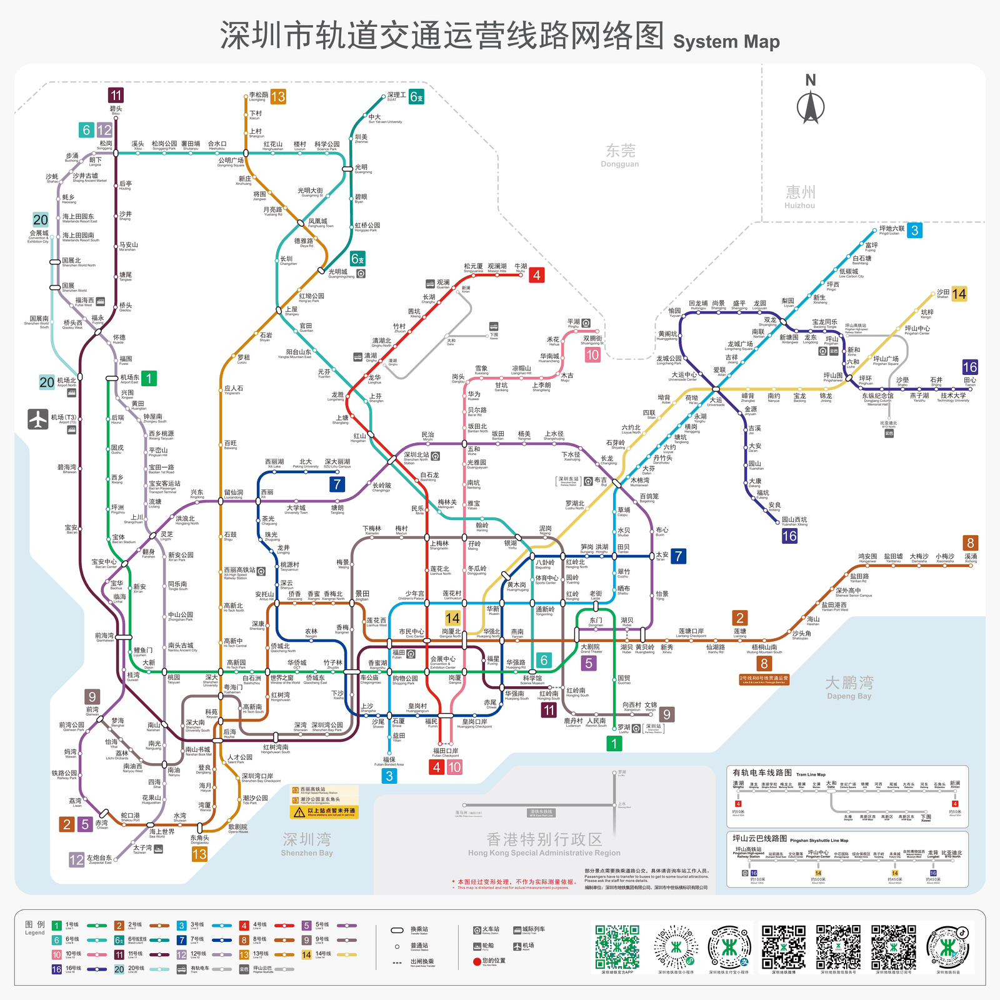

# 8 城地铁运营效能对比分析（2025.01–2026.05）

以「运营里程」为规模轴、「客运强度」为效率轴，用 8 座城市 17 个月的轨道交通面板数据做四象限定位，回答三个问题：

- 深圳是否真的「小而强」？
- 成都、重庆是否陷入「大而弱」的规模陷阱？
- 北京、上海作为超大城市，效率是否已触及天花板？

## 数据

四类公开数据源交叉核对：

| 来源 | 用途 |
|---|---|
| 中国城市轨道交通协会《城市轨道交通 2025 年度统计和分析报告》 | 运营里程、客运量基准 |
| 交通运输部城市轨道交通运营数据月度速报 | 逐月客运量、进站量 |
| 8 城地铁官网运营数据 | 补充与校验 |
| 国家统计局《国民经济和社会发展统计公报》 | 建成区面积、常住人口 |

**运营面板数据**：8 城 × 17 个月（2025.01–2026.05）＝ **136 条**

| 字段 | 说明 |
|---|---|
| 月份 | 2025-01 至 2026-05 |
| 城市 | 北京、上海、广州、深圳、成都、重庆、杭州、武汉 |
| 运营里程 (km) | 当月线网总里程 |
| 客运量 (万人次) | 当月完成的客运位移服务量 |
| 进站量 (万人次) | 当月进站人数 |
| 客运强度 (万人次/km·日) | 客运量 ÷ 运营里程 ÷ 当月天数，衡量单位里程的客流承载效率 |
| 备注 | 当月是否有新线开通或旧线关停 |

**城市维度数据**：8 条 —— 城市、占地面积、建成区面积、常住人口、建成区常住人口。

## 方法

1. **数据清洗**：pandas 逐列核对缺失值（结果为 0），统一字段类型；月份由 `Jan-25` 字符串转为 `Period` 时间类型，便于按月聚合。
2. **多表关联**：运营面板与城市维度数据按「城市」字段关联。
3. **派生指标**：新增「建成区线网密度」（运营里程 ÷ 建成区面积）与「人口密度」（常住人口 ÷ 占地面积），用于修正城市体量差异，避免只看绝对里程。
4. **四象限划分**：以运营里程中位数 **677.0 km**、客运强度中位数 **1.0227 万人次/km·日** 为分界线，将 8 城划入四个象限。

> **为什么用中位数而不是均值**：北京、上海里程远超其他城市，均值会被极值拉高，中位数更能代表中间水平，避免象限划分被两个超大城市带偏。

## 结论

| 象限 | 城市 | 解读 |
|---|---|---|
| 低规模 · 高效率 | **深圳** | 唯一落入该象限的城市。里程低于中位数，客运强度却远超中位线，形成断层领先。依托极高建成区人口密度与紧凑城市形态，实现了线网的高效集约利用——「小」是阶段性规模状态，「强」是结构性效率优势。 |
| 高规模 · 低效率 | **成都** | 唯一落入该象限的城市。线网规模位居前列，客运强度未达中位水平，反映线网扩张速度超前于客流培育节奏，已进入「规模—效率」再平衡的关键窗口期。 |
| 低规模 · 低效率 | **重庆** | 常被误读为「大而弱」，实为「小且弱」。山地地形抬高了线网铺设与客流组织成本，与公众印象中的「大城市」存在偏差。 |
| 高规模 · 高效率 | **北京、上海、广州** | 规模与效率双高，但已进入高位平台期，边际提升空间收窄。 |

## 可视化



## 文件结构

```
metro-8city-analysis/
├─ metro_analysis.ipynb              # 完整分析过程：清洗 → 派生指标 → 四象限
├─ data/
│   ├─ 8城轨道交通运营数据_202501-202605.csv    # 原始面板数据
│   ├─ 8城核心数据_2025.csv                     # 原始城市维度数据
│   ├─ 8城轨道交通运营数据_clear.csv            # 清洗后
│   └─ 8城核心数据_clear.csv                    # 清洗后
├─ img/                               # 8 城线网图
└─ README.md
```

## 复现

```bash
pip install pandas matplotlib jupyter
jupyter notebook metro_analysis.ipynb
```

按单元格顺序执行即可复现全部图表与结论。

## 技术栈

Python · pandas · matplotlib · Jupyter Notebook

---

数据分析与可视化均由本人独立完成，数据来源于上述公开渠道，结论仅供学习交流。
